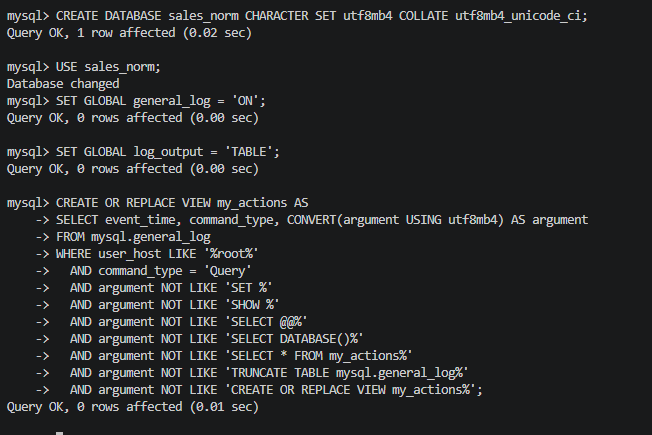
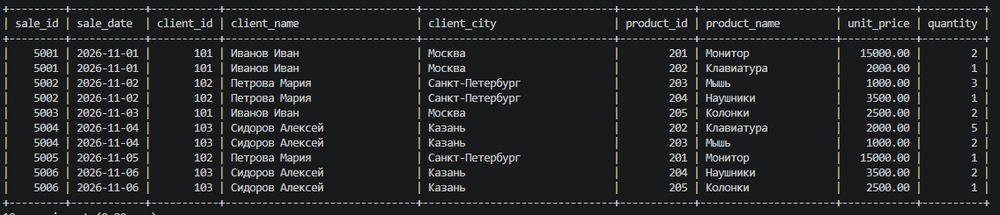
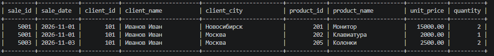
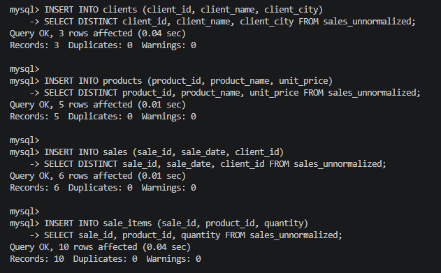
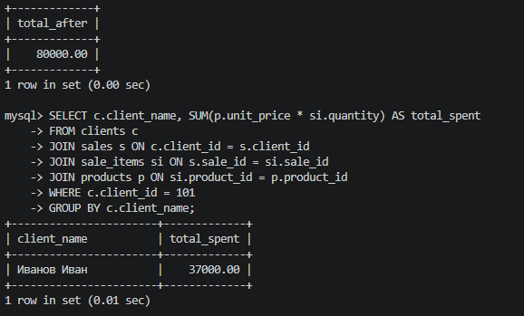
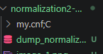
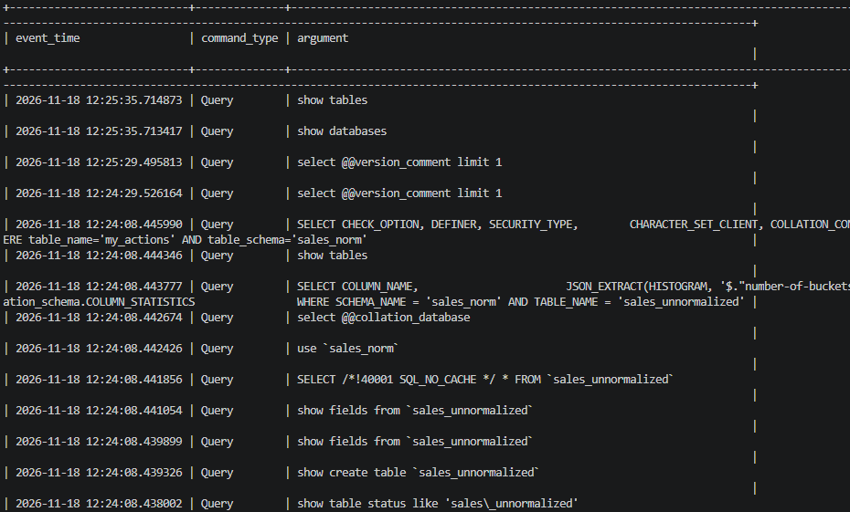
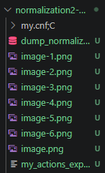

# Лабораторная работа №2 (по нормализации): Приведение к 3NF

## Цель работы
Изучение процесса нормализации базы данных от ненормализованной таблицы до третьей нормальной формы (3NF), а также ведение лога действий пользователя.

## Ход работы
1. Создана база `sales_norm` и "плохая" таблица `sales_unnormalized`.
2. Продемонстрированы аномалии обновления, удаления и вставки.
3. Выполнена нормализация до 3NF: созданы таблицы `clients`, `products`, `sales`, `sale_items`.
4. Данные перенесены из "плохой" таблицы в нормализованные.
5. Проверено, что данные не потерялись и аномалии исчезли.
6. Создан дамп базы (`dump_normalization.sql`).
7. Экспортирован лог действий (`my_actions_export.log`).

## Скриншоты

### Создание БД и VIEW

### Исходная таблица

### Аномалия обновления

### Нормализованные таблицы

### Проверка суммы

### Файлы дампа и лога

### Лог через VIEW

### Файлы дампа и лога

## Результаты
В папке проекта находятся:
- `dump_normalization.sql` — дамп базы данных `sales_norm` (создан с флагом `--skip-lock-tables`).
- `my_actions_export.log` — лог действий пользователя.